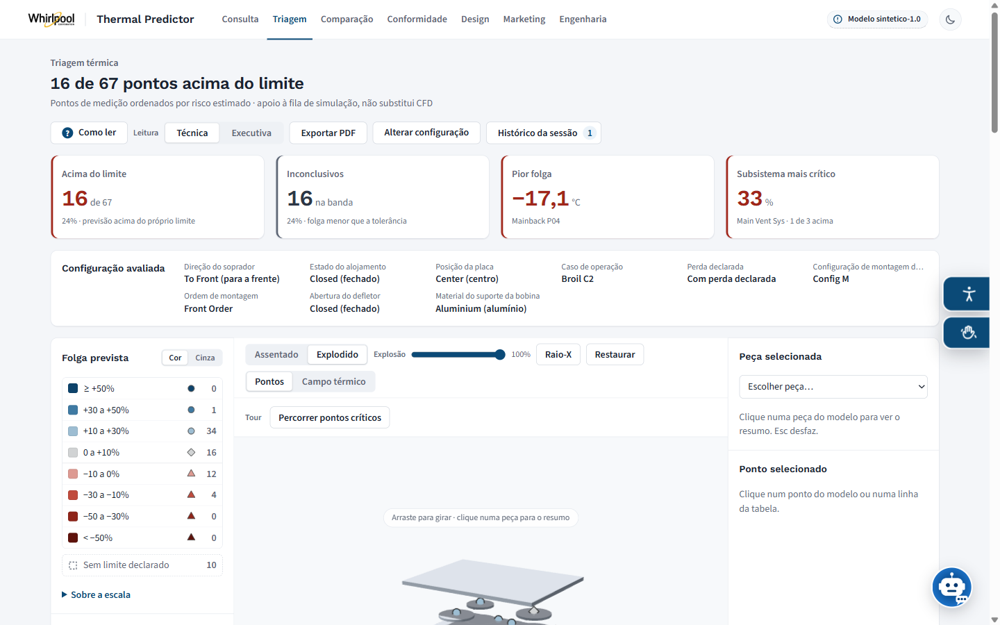
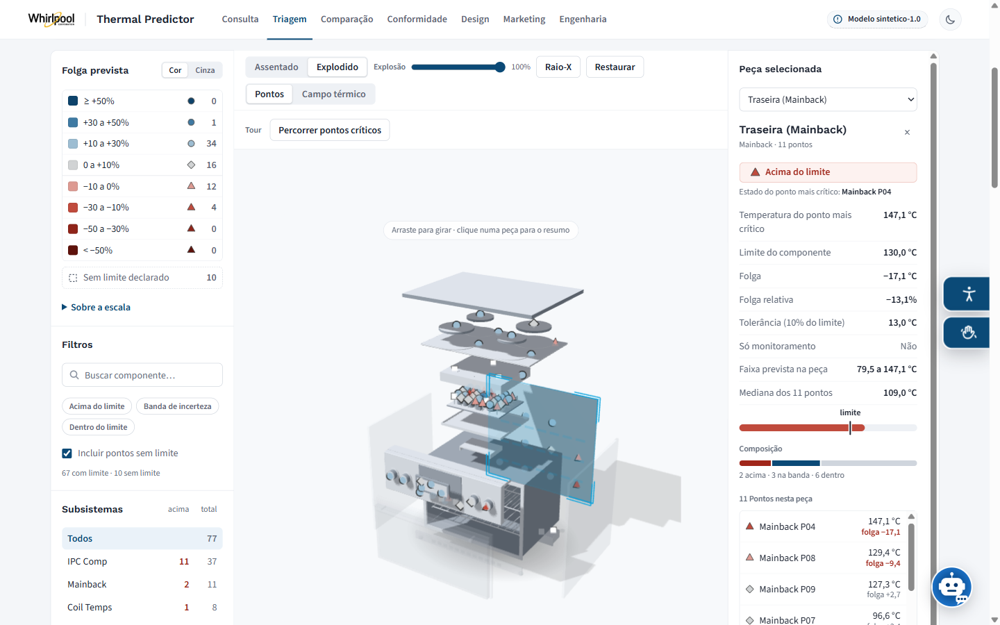
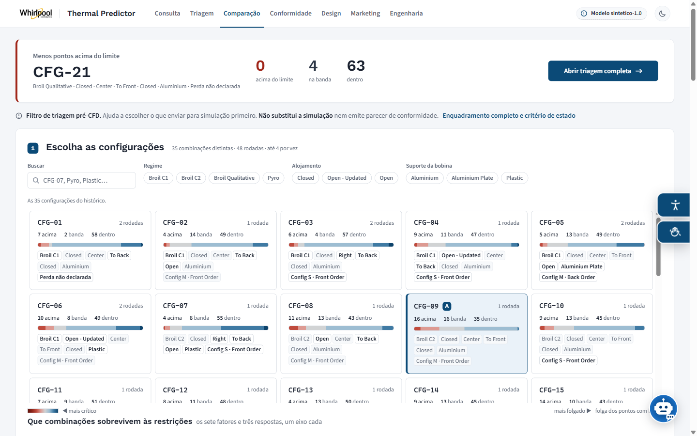
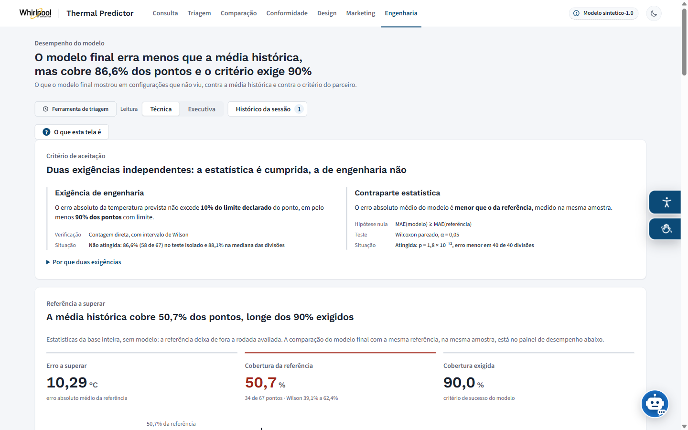
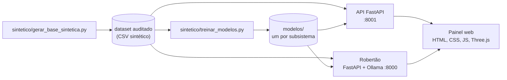

# Thermal Predictor


Triagem térmica de fogões de piso com machine learning, desenvolvida no Inteli em parceria com a divisão de fogões da **Whirlpool**, que atende os mercados brasileiro e mexicano. O projeto prevê a temperatura de cada componente de um fogão em uma configuração ainda não ensaiada e traduz essa previsão em uma decisão de risco, para que a engenharia simule primeiro o que tem chance real de passar.

> 🔒 **Sobre os dados.** A base de ensaios térmicos é da Whirlpool, é confidencial e é protegida por acordo entre o Inteli e o parceiro. **Esta versão pública não contém nenhum dado real.** A base de ensaios, os limites de temperatura, os nomes dos pontos de medição e os modelos treinados são sintéticos, gerados pelos scripts de [`sintetico/`](sintetico/). Os números exibidos pelo painel demonstram o funcionamento do sistema, e não o resultado do projeto.

## Telas

Capturas do painel rodando sobre a base sintética (nenhum dado real):

| Triagem de uma configuração | Fogão 3D com a peça selecionada |
|---|---|
|  |  |
| **Comparação entre configurações** | **Engenharia: critério, referência e hipóteses** |
|  |  |

## O problema

Cada componente de um fogão tem uma temperatura máxima admissível, definida pela especificação do próprio componente ou pelas normas de segurança: no Brasil, a Portaria Inmetro nº 8/2022, com referência técnica na ABNT NBR 13723-1, e no México, a NOM-010-SESH-2012. Ultrapassar esse limite compromete materiais, cria risco para o consumidor e impede a certificação. A dificuldade é que partes com exigências opostas convivem no mesmo produto: a cavidade do forno opera a centenas de graus, enquanto a eletrônica do console falha muito antes disso.

Hoje, verificar essa condição exige simulação numérica de fluidos (CFD), que leva semanas por produto e depende de licenças caras, ou a montagem de protótipos físicos. O Thermal Predictor não substitui essa verificação: ele **tria**, filtrando em segundos, ainda na fase conceitual, as configurações sem chance de passar, para que a fila de simulação receba apenas candidatas plausíveis.

## A solução

| Peça | O que faz |
|---|---|
| **Modelo preditivo** | Um modelo por subsistema do fogão (média de Random Forest e Gradient Boosting, SVR ou Extra Trees, escolhidos por comparação) prevê a temperatura de cada ponto de medição a partir de sete fatores de projeto. |
| **Painel web** | Compara a temperatura prevista com o limite de cada componente e mostra o risco em um fogão 3D interativo, com leituras para engenharia, conformidade, design e marketing, comparação entre configurações e exportação em PDF e planilha. |
| **API de predição** | FastAPI que serve a previsão, o catálogo de configurações, os metadados dos modelos e o desempenho agregado. |
| **Robertão** | Assistente de IA que roda localmente (LLM via Ollama), explica os conceitos do projeto, consulta os ensaios e executa o modelo, sem enviar nenhum dado para a internet. |

O painel também foi pensado para quem tem necessidades de acessibilidade: tamanho e espaçamento de fonte, fonte legível, guia e máscara de leitura, alto contraste, modos para daltonismo, leitor de voz e tradução em Libras pelo VLibras.

## Arquitetura



A previsão segue a mesma codificação no treino, na API e no assistente: o script de treino importa a função de codificação da própria API, então o vetor que o modelo vê no treino é o mesmo que ele recebe em produção.

## Como o modelo é avaliado

O protocolo de avaliação do projeto está implementado em [`sintetico/treinar_modelos.py`](sintetico/treinar_modelos.py) e roda sobre a base sintética:

- **validação agrupada por configuração:** réplicas de uma mesma configuração de ensaio nunca ficam uma no treino e outra no teste, o que evitaria um vazamento de dados que infla o resultado;
- **teste isolado e 40 divisões sorteadas**, para medir o erro e a sua variação;
- **referência honesta:** o modelo é comparado com a média histórica de cada ponto, e não com a média global, que favoreceria o modelo;
- **critério de aceite do parceiro:** erro dentro de 10% do limite em pelo menos 90% dos pontos, com intervalo de Wilson;
- **regra de risco RN-01:** acima do limite, banda de incerteza a menos de 10% do limite ou dentro dele, com sensibilidade, falsos negativos e falsos positivos;
- **teste de Wilcoxon pareado** entre o erro do modelo e o da referência, divisão a divisão.

O mesmo script calcula, com [`sintetico/estatisticas_da_base.py`](sintetico/estatisticas_da_base.py), as estatísticas da base que a tela de engenharia exibe sem nenhum número fixo no HTML: a cobertura da referência com intervalo de Wilson, o desenho da validação, a procedência das leituras ausentes, as hipóteses sobre o dado (concentração do risco por qui-quadrado com reamostragem, risco por modo de teste com permutação e Mann-Whitney, correlação entre limite e variabilidade, normalidade por Shapiro-Wilk) e os parâmetros do escalonamento em z.

No projeto, o resultado sustentou o uso do modelo como **ferramenta de triagem**, e não como substituto da simulação, ressalva que acompanha todas as telas.

## Estrutura do repositório

```text
.
├── sintetico/                 # Base sintética, treino, estatísticas da base e fixtures dos testes
├── dashboard/                 # Painel web (HTML, CSS e JavaScript puro, Three.js)
│   ├── api/                   # API FastAPI de predição, com testes (pytest)
│   ├── js/  css/              # Núcleo, telas, leituras por público, visual 3D, acessibilidade
│   └── testes/                # Testes do painel (node:test)
├── llm/                       # Robertão: chatbot local com Ollama, ferramentas e RAG opcional
├── notebooks/utils/           # Módulos do pipeline de modelagem (métricas, comparação, bootstrap, FEM)
├── assets/dashboard/          # Logos e avatar usados pelo painel
└── requirements.txt           # Bibliotecas dos scripts de sintetico/
```

Os notebooks e a documentação acadêmica do projeto trabalham sobre a base real e por isso não fazem parte desta versão. Comentários do código que citam seções da documentação se referem a esse material.

O histórico de commits é o do repositório original do time, com a autoria de cada integrante, filtrado para guardar só o código publicado aqui: notebooks, documentação e dados ficaram de fora, e os nomes dos pontos de medição e os números da base real foram substituídos em todas as versões.

## Como executar

Requisitos: Python 3.11 ou mais recente e Git. Para os testes do painel, Node.js 20 ou mais recente.

**1. Preparar o ambiente e gerar a base sintética**

```sh
git clone https://github.com/JoseIsaias-AI/Thermal-Predictor.git
cd Thermal-Predictor
python -m venv .venv
# Windows: .venv\Scripts\activate    macOS/Linux: source .venv/bin/activate
pip install -r requirements.txt
python sintetico/gerar_base_sintetica.py
```

**2. Treinar os modelos** (alguns minutos; `--divisoes 10` deixa a avaliação mais rápida)

```sh
python sintetico/treinar_modelos.py
```

**3. Ligar a API de predição**

```sh
cd dashboard
pip install -r api/requirements.txt
uvicorn api.main:app --port 8001
```

**4. Abrir o painel.** Em outro terminal, na raiz do repositório, sirva os arquivos na porta 5500, a origem que a API aceita, e abra `http://127.0.0.1:5500/dashboard/index.html`:

```sh
python -m http.server 5500
```

No VS Code, a extensão Live Server faz o mesmo.

**5. Robertão (opcional).** Instale o [Ollama](https://ollama.com/download) e baixe o modelo com `ollama pull qwen3:4b`. Depois:

```sh
cd llm
pip install -e ".[dev]"
cp .env.example .env
uvicorn thermal_chatbot.api:app --host 127.0.0.1 --port 8000
```

O assistente aparece no canto inferior direito do painel. Detalhes da arquitetura, das ferramentas e do RAG estão em [`llm/README.md`](llm/README.md).

## Testes

```sh
node --test "dashboard/testes/*.test.js"   # painel
cd dashboard/api && pytest                  # API (depois do passo 2)
cd llm && pytest                            # chatbot
```

## Minha participação

Projeto em grupo do módulo 3 de Engenharia de Computação do Inteli. Minha participação se concentrou em ciência de dados e modelagem:

- formulação e verificação das hipóteses estatísticas, testes de normalidade e escalonamento das variáveis;
- estratégia de treino, validação e teste, com validação agrupada por configuração;
- treinamento de Random Forest e Gradient Boosting e comparação de algoritmos com Grid Search, Random Search e explicabilidade por SHAP;
- estudo de aumento de dados por bootstrap, com validação estatística das amostras e medição do impacto nos modelos;
- estudo, projeto e implementação de simulação térmica por elementos finitos integrada ao pipeline, com a decisão de não adotá-la registrada a partir da comparação;
- ficha técnica e testes do modelo final por dataset, conclusões e recomendações ao parceiro.

## Equipe

**Os Preditivos:**
[Bernardo de Assis Bittencourt e Silva](https://www.linkedin.com/in/bernardo-bittencourt-27b8643aa/),
[Gustavo da Silva Gomes](https://www.linkedin.com/in/gustavo-gomes-437b94312/),
[Igor da Silva Rodrigues](https://www.linkedin.com/in/igor-dasilva-rodrigues/),
[José Isaías Menezes Santos](https://www.linkedin.com/in/joseisaias/) e
[Vinícius Ferreira da Costa](https://www.linkedin.com/in/viniciusferreirac/).

**Orientador:** [Fábio Cássio de Souza](https://www.linkedin.com/in/fabiocassiosouza/).
**Instrutores:** [Egon Ferreira Daxbacher](https://www.linkedin.com/in/egondaxbacher/),
[Geraldo Magela Severino Vasconcelos](https://www.linkedin.com/in/geraldo-magela-severino-vasconcelos-22b1b220/),
[Heloisa Caroline de Souza Pereira Candello](https://www.linkedin.com/in/heloisacandello/),
[José Roberto Cândido da Silva](https://www.linkedin.com/in/roberto-c%C3%A2ndido-450582a0/) e
[Laíza Ribeiro Silva](https://www.linkedin.com/in/laizaribeiro/).

## Licença

Thermal Predictor, por Inteli, Bernardo de Assis Bittencourt e Silva, Gustavo da Silva Gomes, Igor da Silva Rodrigues, José Isaías Menezes Santos e Vinícius Ferreira da Costa, está licenciado sob [Creative Commons Attribution 4.0 International](http://creativecommons.org/licenses/by/4.0/). A marca e o logotipo Whirlpool pertencem à Whirlpool Corporation e aparecem no painel apenas para identificar o parceiro do projeto.
